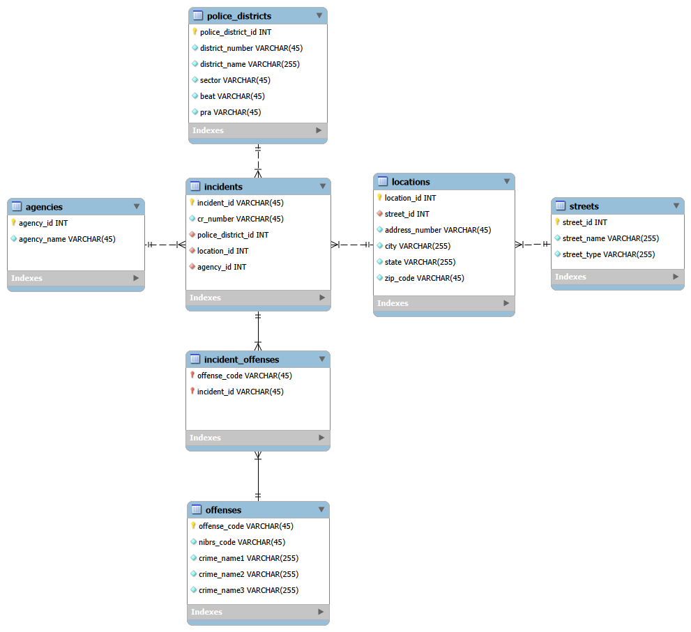
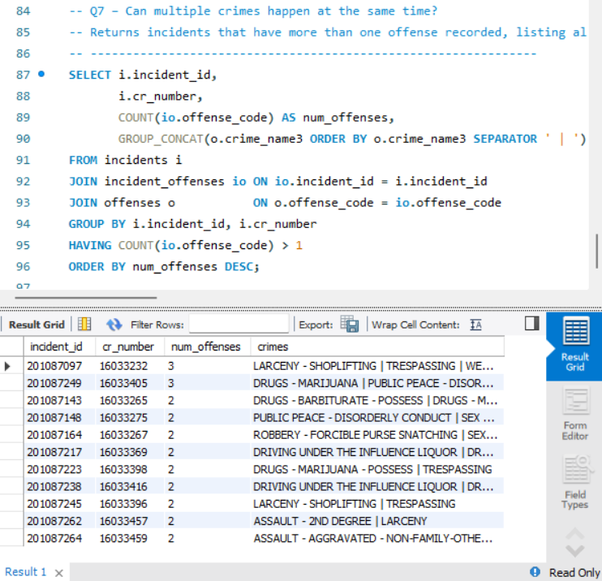

# Montgomery County Crime Database

A normalized relational database (MySQL) built from Montgomery County, MD public crime data. It models incidents, offenses, locations, streets, police districts, and reporting agencies, and includes SQL views and queries for analyzing crime patterns by location, district, and offense type.

Group project for **INST327 (Database Design)** at the University of Maryland, Spring 2026 (5-person team).

**My contribution:** Designed the ERD, built the database and all setup/import scripts, and wrote most of the SQL queries (Queries 1, 2, and 7 in particular). Teammates contributed additional queries and the written report.

---

## Purpose

Crime patterns in Montgomery County vary by neighborhood, police district, and location. This database organizes a subset of the county's crime data so that questions like *"Which cities have more incidents than average?"* or *"Can multiple crimes happen in the same incident?"* can be answered with a single query.

Intended users: law enforcement agencies, researchers, public policy committees, and government officials.

## Tech Stack

- MySQL
- MySQL Workbench (ERD modeling)
- SQL (DDL, JOINs, aggregation, subqueries, views)

## Database Design



`incidents` is the central table. Every incident links to a police district, a location, and a reporting agency, and can have multiple offenses.

| Table | Purpose | Key columns |
|---|---|---|
| `incidents` | Central table, one row per reported incident | `incident_id` (PK), `cr_number`, `police_district_id` (FK), `location_id` (FK), `agency_id` (FK) |
| `agencies` | Law enforcement agencies that handled incidents | `agency_id` (PK), `agency_name` |
| `police_districts` | District, sector, beat, and PRA info | `police_district_id` (PK), `district_number`, `district_name`, `sector`, `beat`, `pra` |
| `locations` | Address-level location details | `location_id` (PK), `street_id` (FK), `address_number`, `city`, `state`, `zip_code` |
| `streets` | Street names and types, split out to reduce redundancy | `street_id` (PK), `street_name`, `street_type` |
| `offenses` | Offense classification (NIBRS code and three levels of crime naming) | `offense_code` (PK), `nibrs_code`, `crime_name1`, `crime_name2`, `crime_name3` |
| `incident_offenses` | Junction table for the many-to-many relationship between incidents and offenses | `offense_code`, `incident_id` (composite PK) |

### Design decisions

- **Junction table (`incident_offenses`)**: a single incident can involve several offenses, and an offense type appears in many incidents. A composite primary key on `(offense_code, incident_id)` models this cleanly.
- **Separate `streets` table**: isolating `street_name` and `street_type` reduces redundancy in `locations` and keeps address data organized.
- **Multi-level offense naming**: `crime_name1`/`2`/`3` (e.g., "Crime Against Person") plus `nibrs_code` mirror how the original county dataset categorizes crime.
- **Scope**: victims, suspects, arrests, and court data were intentionally excluded to keep the schema focused and finishable.

## Repository Structure

```
montgomery-county-crime-db/
├── README.md
├── schema/
│   ├── group_8_montgomery_county_crime_backup.sql   # schema + sample data
│   └── group_8_logical.mwb                          # MySQL Workbench ERD model
├── sql/
│   ├── group_8_views.sql
│   └── group_8_queries.sql
└── docs/
    └── erd.png
```

## Getting Started

**Requirements:** MySQL 8.x and (optionally) MySQL Workbench.

1. Import the database (schema and sample data):
   ```bash
   mysql -u <your_user> -p < schema/group_8_montgomery_county_crime_backup.sql
   ```
   If the dump does not create the database itself, run `CREATE DATABASE montgomery_county_crime;` first and import with the database name added to the command.
2. Create the views:
   ```bash
   mysql -u <your_user> -p montgomery_county_crime < sql/group_8_views.sql
   ```
3. Run the queries in `sql/group_8_queries.sql` from the command line or MySQL Workbench.

To view or edit the ERD, open `schema/group_8_logical.mwb` in MySQL Workbench.

## Views

| View | Description |
|---|---|
| `full_incident_details` | Flat view joining all tables: agency, location, street, district, and offense for each incident |
| `incidents_per_agency` | Incidents handled by each agency, ranked |
| `top_offenses` | Every offense type ranked by how often it was charged |
| `incidents_by_city` | Total incidents per city, ranked |
| `incidents_by_district` | Total incidents per police district, ranked |

## Queries

| # | Question | Techniques |
|---|---|---|
| Q1 | Are certain types of crimes more prevalent in specific locations? | 5-table JOIN, GROUP BY |
| Q2 | Which areas experience the highest amount of reported crime? | View, ORDER BY |
| Q3 | What types of crime occur most frequently in Montgomery County? | View, ORDER BY |
| Q4 | Which cities have more incidents than the county average? | Subquery, AVG |
| Q5 | How many person crimes occurred per police district? | 4-table JOIN, WHERE filter, GROUP BY |
| Q6 | Which incidents in Silver Spring involved more than one offense? | WHERE + HAVING |
| Q7 | Can multiple crimes happen at the same time? | HAVING, GROUP_CONCAT |

### Example: Q7, incidents with multiple offenses

```sql
SELECT i.incident_id,
       i.cr_number,
       COUNT(io.offense_code) AS num_offenses,
       GROUP_CONCAT(o.crime_name3 ORDER BY o.crime_name3 SEPARATOR ' | ') AS crimes
FROM incidents i
JOIN incident_offenses io ON io.incident_id = i.incident_id
JOIN offenses o           ON o.offense_code = io.offense_code
GROUP BY i.incident_id, i.cr_number
HAVING COUNT(io.offense_code) > 1
ORDER BY num_offenses DESC;
```




## Data

- **Source:** [Montgomery County Open Data Portal, Crime dataset](https://data.montgomerycountymd.gov/Public-Safety/Crime/icn6-v9z3/about_data)
- **Sample:** a subset of 100-300 records selected for this project. The data preparation (cleaning and reshaping the county's flat file to fit the normalized schema) was one of the most time-consuming parts of the project.

## Ethics and Limitations

- **Privacy:** location data can be sensitive. The design called for truncated coordinates rather than precise values, but block-level location information can still risk exposing private contexts.
- **Bias:** the data reflects *reported* crime, not all criminal activity. Conclusions about neighborhoods should account for socioeconomic factors and the effects of over-policing.
- **Use:** this database is one tool among many, not a definitive measure of community safety.

## Future Work

- Year-over-year trend analysis for specific crimes
- Expand beyond the sample subset to multiple years of data for better statistical reliability
- Add census or public health context to account for social conditions
- Build a dashboard/front end for non-technical users
- Extend the schema with arrest outcomes and agency response times

## Team

Group 8, INST327, University of Maryland

- Orle J Guerrero

